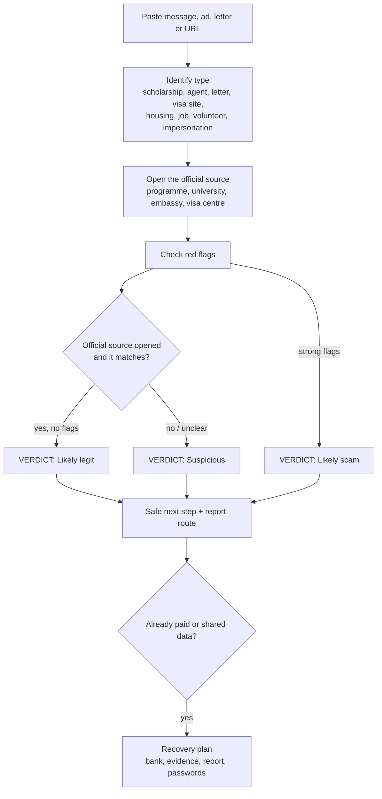

# Scholarship & Visa Scam Checker

> Paste a suspicious scholarship, visa, admission, housing, volunteer or job-abroad offer. Get a clear verdict and safe next steps before you pay or send documents.

[](LICENSE)
[](SKILL.md)
[](CHANGELOG.md)
[](#pricing)

> **Compatibility:** works best with web search on, so the skill can open the official programme, embassy or visa-centre page. Without browsing it still lists red flags, but it never gives a `Likely legit` verdict.

---

## Why it exists

Students and applicants are targeted exactly when they are most stressed: waiting for a scholarship result, hunting for a visa slot, or looking for a room in a city they've never seen.

- **Fake "pre-selection" fees.** Programmes such as Stipendium Hungaricum and Erasmus+ publicly warn that applying is free, yet "pay a processing fee in 24 hours" messages keep circulating on WhatsApp and Telegram.
- **Lookalike visa sites and slot sellers.** Visa centres say they don't sell appointments, and VFS Global reports taking down hundreds of fake sites.
- **Agents and fake letters.** "Guaranteed visa" packages and forged admission letters have led to refusals, airport detentions and deportations.
- **Housing deposits.** Rental-fraud reports among students in the Netherlands rose sharply between 2022 and 2024.
- **Job-abroad fees.** Recruiters ask for "visa fees", and some fake job offers lead to trafficking into scam centres.

Generic scam checkers look at bank texts and parcel messages. This skill knows how real scholarships, visa centres, universities and volunteer programmes behave, and compares the message against the official page.

## Features

- **Three-level verdict:** `Likely legit` (only with an official source opened in the session), `Suspicious`, or `Likely scam`.
- **Red flags found, quoting the exact words** that triggered them: fees for free things, guarantees, pressure, unofficial senders, payment method, lookalike domains, unverifiable letters, housing and job-abroad patterns.
- **Domain check:** compares the real registrable domain with the one the embassy or programme links to (extra words, typos, other endings, brand hidden in a subdomain, free mailboxes).
- **Domain age** (one signal, never a verdict alone): creation date from a connected WHOIS/RDAP tool or the public RDAP record; without either, a 2-step lookup.icann.org check for you. A brand-new domain claiming to be an embassy, visa centre or scholarship body is a strong flag. Ages are never guessed.
- **Job offer mode:** who really pays the work permit or visa (UK sponsor costs, Canada LMIA, Poland work permit, Germany, with official links), pay vs typical pay (marked *estimate*), an offer-letter and contract checklist (legal name, address, signatory, e-mail domain, no fee clause, passport not kept), and a lookup in the official business register (Companies House, KRS, Handelsregister, EU registers, Corporations Canada, Azerbaijan taxpayer search) with a call-back on the register's number, never the one in the offer. `Likely legit` only when the register entry was opened.
- **Trafficking warning in plain words** when a job offer asks for fees or your passport, plus the national anti-trafficking hotline when its official page is verified (for example 152 in Azerbaijan).
- **UN and volunteering offer mode:** the UN never charges a fee at any stage, visa fees included (un.org fraud alert, UNCDF/UNV scam alerts); UN Secretariat posts are on careers.un.org and UN Volunteer posts on app.unv.org (other agencies use their own official site); lookalike UN domains, "refundable" fees, Gmail senders and moves to WhatsApp or Telegram are flagged; agencies that charge to place you as a "UN volunteer" are not the UN route; European Solidarity Corps volunteers pay nothing to take part (Your Europe and the ESC info kit).
- **What's normal:** what the real programme, university, embassy or visa centre does and charges, with the official link.
- **Safe next steps** that verify through contacts on the official website, never through the message.
- **How to report:** platform, impersonated organisation, visa-centre fraud page, national cybercrime or consumer body.
- **Already paid?** An ordered recovery plan: bank or payment provider, evidence, report, passwords, plus a warning about "recovery" scammers who target victims a second time.
- **Templates:** verification e-mail to an official office, report checklist, already-paid recovery checklist.
- **Privacy guard:** if you paste a passport number, card number or password, it tells you not to share it and never repeats it.
- **Answers in your language** (Azerbaijani, Turkish, Russian, Uzbek, Urdu, Arabic, English…). Phone mode by default: next action first, the verdict block, and no more than 8 lines of text.

## What it never does

- **Never accuses a named person or organisation** of fraud as a fact. It describes the signals and says when a message matches a known scam pattern.
- **Never asks for passwords, card numbers, passport or ID numbers.** The check works on the message, link and sender alone.
- **Never says "legit" without an official source** it opened in the session.
- **Never contacts anyone, pays, or reports on your behalf.** You stay in control.
- **Never gives legal advice.**

## Plan compatibility

Works on **every Claude plan: Free, Pro, Max and Team**. Turn on *Settings → Capabilities → Code execution and file creation* (Skills need it; every plan has it). Without web search it never says "Likely legit" and asks you to paste the official page. No scheduled tasks are needed. On tight Free limits, one message = one check. Checked against [claude.com/pricing](https://claude.com/pricing) on 2026-11-10.

## Pricing

**Free.** This is a separate, standalone skill. There is no paid tier inside it, no gated features and no checkout link.

## Installation

### Claude Code

```bash
git clone https://github.com/codelady-ship/scholarship-visa-scam-checker.git
cp -r scholarship-visa-scam-checker ~/.claude/skills/scholarship-visa-scam-checker
```

Or put it in one project at `<project>/.claude/skills/scholarship-visa-scam-checker/`. Claude Code picks the skill up from the `description` in `SKILL.md` when a request matches.

### Claude app (web, desktop, iOS, Android)

1. Turn on **Code execution** under **Settings > Capabilities** (skills need it).
2. Zip the folder so that `SKILL.md` sits inside it (`scholarship-visa-scam-checker/SKILL.md`), or build the clean package with `./scripts/build-agensi-zip.ps1`.
3. Go to **Customize > Skills**, click **+**, choose **Create skill → Upload a skill**, and upload the zip.
4. Turn the skill on and start a chat.

Once uploaded, the skill also works in the Claude iOS and Android apps, which is handy when the suspicious message arrives on your phone.

### Other agents

`SKILL.md` is plain Markdown with YAML front matter. Any agent that reads skill or instruction files, or accepts a system prompt, can use it.

### Packaging for Agensi

```powershell
./scripts/build-agensi-zip.ps1
```

This writes `dist/scholarship-visa-scam-checker.zip` (`dist/` is git-ignored) with one top-level folder containing only `SKILL.md`, `templates/`, `examples/` and `CHANGELOG.md`.

## Usage

Example prompts:

1. *"I got a WhatsApp message saying I'm pre-selected for a scholarship and must pay $150 in 24 hours. Is it real?"*
2. *"Is vfs-visa-appointment-priority.com the real site for booking my student visa?"*
3. *"A landlord in Amsterdam wants a deposit by Western Union before I can see the room. I already paid €400. What now?"*

Sample output (fictional case):

```
VERDICT: Likely scam
Red flags:
• "pay the processing fee of USD 150" — SH applications are free
• "within 24 hours", "Limited seats!" — pressure
• Unsolicited WhatsApp + a gmail.com address, not the official domain
What's normal: SH applications are free and run through the official portal —
https://stipendiumhungaricum.hu
Safe next step: Don't pay. Ask the programme via the contact on its official site.
Report: WhatsApp → Report + block; national cybercrime unit/police.
```

Full worked cases are in [`examples/`](examples/). Reusable templates are in [`templates/`](templates/).

Research behind the features: [`docs/research.md`](docs/research.md). Test prompts and expected behaviour: [`tests/evals.md`](tests/evals.md).

## How it works



## Limitations

- **Not legal advice**, and not a guarantee. `Suspicious` means "verify first", not "proven fraud". `Likely legit` means the message matches the official source the skill opened, not that every detail was confirmed.
- Scam patterns and official rules change. Always confirm on the current official page.
- Needs web access to open official pages. Without it, the skill can only list red flags and labels everything as unverified.
- Reporting channels differ by country and change often; the skill looks them up or marks them `verify`.
- It can't trace payments, recover money or take down sites. Your bank, the platform and the police can.

## Related skills (optional, paid)

For a full plan beyond the scam check:

- **Study & Volunteer Abroad Copilot**: finds fully funded scholarships and volunteering (Stipendium Hungaricum, Türkiye Bursları, Erasmus Mundus, DAAD, ESC), checks eligibility, writes honest CVs and motivation letters, tracks deadlines.
- **Student Travel Copilot**: from admission letter to your first 30 days abroad: visa file with official links, document consistency, proof of funds, housing, budget and arrival deadlines.
- **Job & Application Copilot**: for a real job search after the scam check: applications, CVs and visa-sponsorship checks. A separate Codelady Abroad skill, coming to Agensi (not listed yet). Job-offer answers mention it by name only, with no link.

## Contributing

1. Fork the repository and create a branch.
2. Cite an official source (programme, embassy, visa centre, police, consumer body) for every new red flag or rule.
3. Never put real people's names, numbers or personal data in examples; use fictional cases and invented domains.
4. Open a pull request explaining what changed and why.

## License

[MIT](LICENSE) © 2026 Antiqa Jalilova

---

Built by Antiqa Jalilova ([@codelady-ship](https://github.com/codelady-ship))
